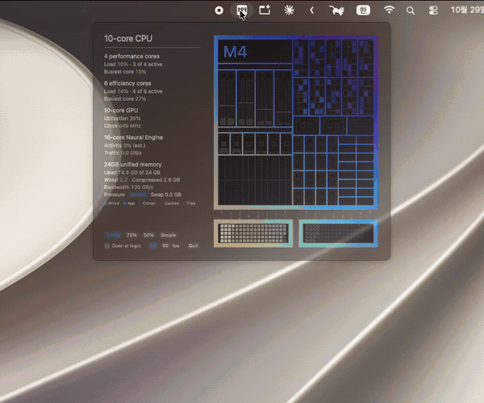

# SiliconMeter

**A menu bar monitor that shows what your Mac's chip is doing — drawn as the chip itself.**



You know the die shots Apple puts up on stage when a new chip comes out? Performance cores, efficiency cores, the GPU, the Neural Engine, all boxed off in neat little blocks. I kept thinking it'd be fun if that picture actually moved. So I built it.

There are plenty of apps that show CPU usage as a bar or a number. SiliconMeter shows the same information **as the chip that's actually inside your Mac**. Each core lights up as hard as it's working, the unified memory below the die fills as you use it, and on an Ultra you can watch traffic pulse back and forth across the UltraFusion bridge.

---

## What makes it different

**1. It draws your chip, not a generic one**
41 configurations are covered, from M1 through M6 plus the A18 Pro in the MacBook Neo. Every generation and every tier (base, Pro, Max, Ultra) has its own floorplan, laid out after Apple's published chip illustrations wherever they exist. Binned models keep their disabled blocks — an 8-core-GPU M3 or a 30-core-GPU M3 Max draws the full grid with the unused cores dimmed — so you can see exactly which variant you have.

**2. Each chip keeps its own colors**
The gradients come from how each chip was introduced. M1 runs peach to blue, M2 amber to violet, M4 goes lime to blue to indigo like the keynote die shot, and the A18 Pro is rose gold.

**3. Every core, individually**
Not one "CPU 37%" average. Each core gets its own live reading and its own glow, so you can tell at a glance whether it's just the efficiency cores ticking along or one performance core pinned at 100%. M5's Super cores and M6's three-tier layout are split out by tier too.

**4. It even catches the Neural Engine**
macOS doesn't expose Neural Engine utilization, and on M4 the usual power counter just reads zero, even under load. So SiliconMeter estimates activity from how much of the time the Neural Engine is holding a memory-bandwidth request, and shows how much data it's moving (GB/s) alongside. Throw a Vision workload at an M4 and it climbs from 0% to the 90s. Estimated values are marked "(est.)".

**5. Practically free while it sits in the menu bar**
Sampling and animation only run while the popover is open. Close it and CPU usage drops to 0%. Even while it's open, everything that doesn't move (the die plate, block outlines, gradients, wiring) is rendered once and cached, and each frame only redraws what changed. On an M4 with the popover open at 30 fps, it sits around 10% of one core.

**6. No sudo, no network**
It never asks for admin rights and never touches the internet. Everything is read on your Mac and stays there.

---

## Features

- **Menu bar icon:** a tiny chip with its name engraved. Base chips are square; Pro, Max and Ultra are tall rectangles marked P, M or U. On non-Retina (1x) displays the lettering switches to a hand-tuned pixel font so it stays crisp.
- **Popover:** a keynote-style spec list on the left (load per core tier, GPU, Neural Engine, memory breakdown, pressure, swap) and the live die on the right.
- **Sizes:** die at 100%, 75% or 50%, plus a Simple mode that's just the big numbers. The popover animates smoothly between them.
- **Frame rate:** 30 or 60 fps. Respects the system's Reduce Motion setting.
- **Open at login:** one checkbox at the bottom of the popover.

---

## What's measured and what's just for show

When you make something look this nice, it's easy to blur the line between real data and decoration. So here it is, plainly:

| On screen | Measured / for show | Source |
|---|---|---|
| Per-core CPU load | **Measured**, one value per core | `host_processor_info` |
| Which cluster and tier each core belongs to | **Measured** | IORegistry `cpuN` nodes, `hw.perflevelN` |
| GPU utilization | **Measured**, one value for the whole GPU (same as Activity Monitor) | IOAccelerator `Device Utilization %` |
| GPU clock | **Measured** | IOReport `GPU Stats` |
| Individual GPU cores lighting up | **For show**: the overall utilization spread across the cores | macOS doesn't report per-core GPU data |
| Neural Engine activity | **Measured** or **estimated (est.)**, depending on the chip | IOReport `SoC Stats`, `PMP`, `AMC Stats`, `Energy Model` |
| Memory usage, pressure, swap | **Measured** (same calculation as Activity Monitor) | `host_statistics64`, sysctl |
| Memory bandwidth figure | Apple's published spec | Per-chip table |
| Pulses running along the wiring | **For show**: speed scales with overall activity | Actual bandwidth isn't measured |

---

## Install

### Download

Grab `SiliconMeter-x.y.z.dmg` from [Releases](../../releases) and drag the app into `Applications`.

> **macOS will block it the first time you open it.** This is a personal project and the app isn't notarized by Apple. Allow it once, either way below, and it opens normally from then on.
>
> - Go to **System Settings → Privacy & Security**, scroll down to "SiliconMeter was blocked…" and click **Open Anyway**. (On macOS 14 and earlier you can also right-click the app in Finder and choose **Open**.)
> - Or in Terminal:
>   ```bash
>   xattr -dr com.apple.quarantine /Applications/SiliconMeter.app
>   ```
>
> You can check the download against the `.sha256` file attached to each release.

### Build it yourself

All you need is Xcode or the Command Line Tools (`xcode-select --install`).

```bash
git clone https://github.com/<your-username>/siliconmeter.git
cd siliconmeter
./scripts/build_app.sh
open build/SiliconMeter.app
```

A build you make yourself skips the first-launch warning entirely.

---

## Requirements

- An Apple Silicon Mac (M1 or later, including the A18 Pro MacBook Neo)
- macOS 13 Ventura or later

Intel Macs aren't supported — the whole point is to show Apple Silicon's layout.

---

## Supported chips

| Generation | Models | Floorplan based on |
|---|---|---|
| M1 | base · Pro · Max · Ultra | Block layout from Apple's official chip illustrations |
| M2 | base · Pro · Max · Ultra | Same |
| M3 | base · Pro · Max · Ultra | Official illustrations (base, Max); Pro built from the same generation's rules and die proportions |
| M4 | base · Pro · Max | Official illustrations |
| M5 | base · Pro · Max · Ultra | Official illustration (base); Pro and Max drawn as a CPU die bridged to a GPU die |
| M6 | base | No illustration published yet, so the layout is an educated guess |
| A18 Pro | MacBook Neo | Official illustration |

All 41 configurations, binned variants included, have been checked one by one. That said, the only real hardware I have is an M4. Every other chip was reviewed in a debug mode that runs the exact shipping code with simulated chip info and load. If you're on a different chip and the layout looks off, please open an issue and paste the output of:

```bash
/Applications/SiliconMeter.app/Contents/MacOS/SiliconMeter --dump
```

That's usually all I need to fix it.

---

## Known limitations

- **No per-core GPU data.** macOS only reports utilization for the GPU as a whole, so the per-core lighting is a visualization of that one number.
- **Neural Engine readings are estimates on some chips**, notably M4 and later, where they're marked "(est.)".
- **It uses a private API (IOReport).** That rules out the Mac App Store, and a future macOS update could stop some values from coming through. If that happens, the affected item shows "Not reported" and everything else keeps working.
- **Not yet tested on a real macOS 13 machine.** The app targets macOS 13, so anything unavailable there is caught at compile time, but I haven't run it on actual Ventura hardware.
- **The M6 layout is a guess.** I'll update it once Apple publishes an illustration.

---

## How it's built

Drawn in SwiftUI and built as a single Swift package with no third-party dependencies. The data layer follows the proven approach in [SiliconScope](https://github.com/kennss/SiliconScope) (MIT), and the M5 core-tier naming follows [Stats](https://github.com/exelban/stats). Full notices are in `THIRD_PARTY_NOTICES.md`.

The large-scale block layout takes its cue from Apple's illustrations, but the fine detail inside each block and all the animation are original, and there's no Apple logo anywhere.

---

## More details

How each value is measured, the reasoning behind every chip's layout, the debug mode and the diagnostic commands are all in [`docs/DEVELOPMENT.md`](docs/DEVELOPMENT.md).

---

## License

MIT. Use it, change it, share it. See [`LICENSE`](LICENSE).

Apple, Apple Silicon, Mac, MacBook, M1–M6 and A18 Pro are trademarks of Apple Inc. SiliconMeter is an independent personal project and is not affiliated with, sponsored by, or endorsed by Apple.
